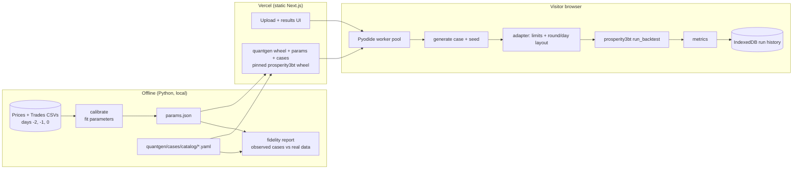
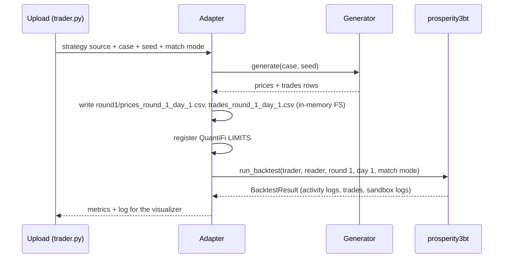
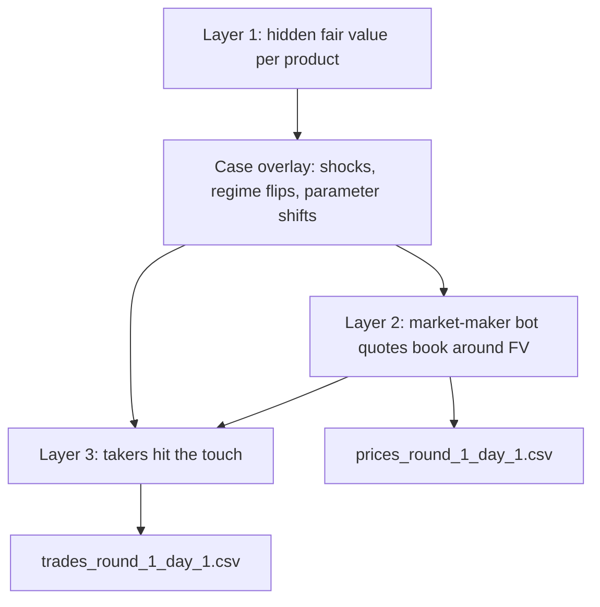

# QuantiFi Backtesting Platform - Implementation Plan

## Goal

Build a web platform, hosted on Vercel, where a user uploads one or more trading strategy files and sees how they would perform on **day 1** of the QuantiFi competition.
Day 1 data does not exist yet, so the platform generates a catalogue of synthetic day-1 datasets.
Each dataset represents a specific, named market case (a regular trading day, a quiet day, a black swan crash, and so on) built from the patterns in the two EDA reports.
Every strategy is run through the `prosperity3bt` backtester on every case.
Each uploaded file is a separate strategy, and the results show, for each strategy, which cases it does well in and which it does poorly in.

**Deadline:** the wiki sets trader file submission for **Nov 1, 11:59 PM** (today is Oct 27).
The phases below are ordered so that a useful local CLI exists early (target Oct 29), the website follows (target Oct 31), and you keep time to improve strategies before the deadline.

What we know from the competition wiki, its rules and the reports:

- Scoring uses several day-1 datasets, each generated differently but from the same underlying patterns.
- Other traders do not react to our orders. The book and the market trade tape are fixed inputs, which is exactly the model `prosperity3bt` implements.
- 26 instruments, 10,000 ticks per day (timestamps 0 to 999,900 in steps of 100), with a 3-level order book plus an anonymous trade tape, in the same `;`-separated format `prosperity3bt` reads.
- Days are continuous: day 1 should open where day 0 closed.
- We do not know the true generating processes or how many bots exist. The reports describe four inferred participant types, but these are inferences, not facts.

## Key design decisions

### 1. The backtest engine is `prosperity3bt`, used as a pinned dependency

We do not write our own matching engine.
`prosperity3bt` (PyPI, MIT) is pinned to **exactly 0.12.0** and used unmodified.
A thin adapter layer handles the three things it does not know about QuantiFi:

- **Position limits.** `prosperity3bt.data.LIMITS` hardcodes the Prosperity 3 products (RAINFOREST_RESIN, KELP, and so on), so a QuantiFi run would fail with a missing key. The adapter registers the 26 QuantiFi limits (AMETHYST 50, LYCHEE 200, vouchers 50 each, and so on) before every run.
- **Data layout.** It reads `round{N}/prices_round_{N}_day_{D}.csv` and `trades_round_{N}_day_{D}.csv` through a `FileReader`. The adapter writes each generated case in that layout, using the existing CSV columns unchanged.
- **Results.** The adapter reads its `BacktestResult` (activity logs, sandbox logs, trades) and computes our per-case metrics from it. Its output log stays compatible with the open-source Prosperity visualizer for deep dives.

Fill rules are its built-in `--match-trades` modes: `all` (market trades at or worse than our quote fill us), `worse` (strictly worse) and `none`.
**The default is `all`**, because the wiki's rule is exactly that: "a passive fill if your price was equal or better than the price someone actually traded at" (a buy at 100 fills on a sell at 99 or 100, not 101).
`worse` stays available as a conservative check.

Two details the wiki leaves open, which contract tests will document:

- **Order lifetime.** `prosperity3bt` matches a resting order against market trades at the same timestamp, then expires it at the end of the tick. The wiki says leftover quantity is "left as an outstanding quote" but does not say for how long. We follow `prosperity3bt`, which mirrors IMC Prosperity, the format the wiki says it copies.
- **Voucher symbols.** The wiki calls them `LYCHEE_VOUCHERS_<strike>`, but the data uses `VOUCHER_<strike>`. The generator emits the data's names, which is what a `trader.py` sees in the CSVs, and the adapter registers limits under both names so either works.
Position-limit enforcement (all orders for a product are cancelled if they could breach the limit), order-book walking and PnL marking all come from `prosperity3bt`, so our numbers match what you already get locally.

### 2. Strategies run in the browser via Pyodide, after a feasibility spike

Uploaded strategies are arbitrary Python code.
Running them in the visitor's browser (Pyodide, which is CPython compiled to WebAssembly, in Web Workers) keeps untrusted code off our servers, avoids function timeouts and compute costs, and runs one case per CPU core.

`prosperity3bt` brings dependencies that need checking under Pyodide before we commit:

| Dependency | Used for | Pyodide status |
|---|---|---|
| `jsonpickle`, `tqdm`, `typer` | traderData, progress bar, CLI | Pure Python, installable with micropip |
| `ipython` | `runner.py` imports `IPython.utils.io.Tee` to capture trader stdout | Pure Python but large; needs verifying |
| `orjson` | `models.py` writes the log output | Compiled Rust extension; it must be in Pyodide's package index, otherwise it needs a shim |

**Phase 0 is a spike** that installs the pinned `prosperity3bt` in Pyodide, runs a sample trader on a real day, and checks that the result matches CPython byte for byte.

**Phase 0 result (Oct 27): go.**
Pyodide 314.0.7 (Python 3.14) ships `orjson` 3.11.8, `ipython` 9.12.0 and `tqdm`; `jsonpickle` and `typer` install from PyPI with micropip, so `prosperity3bt==0.12.0` installs with all its declared dependencies and needs no shims.
A full real day (day 0, 26 products, 10,000 ticks) gives an identical activity-log SHA-256 in CPython 3.12 and Pyodide.
Runtime is 5.4 s in CPython and 7.6 s in Pyodide (about 1.4x), plus about 10 s of one-off setup per worker.
The Vercel Sandbox fallback is not needed.

- If it passes, we use Pyodide.
- If only `orjson` or `IPython` is the blocker, we install with `--no-deps` and provide a small, tested compatibility module that covers only logging and stdout capture, never matching. This counts as a deviation from "unmodified", so I will confirm it with you first.
- If Pyodide is not viable, the fallback is Vercel Functions (Python runtime) that run one case per invocation inside Vercel Sandbox microVMs, which isolate untrusted code.

### 3. Every dataset is a named market case

Each dataset answers one question: "how does my strategy do if day 1 looks like *this*?"
A case is a documented scenario with its own parameter settings, and each case is generated from several seeds so that one lucky path cannot decide the result.
Results are reported per case first and aggregated second, so you can see, for example, that a strategy is great on regular days but loses heavily in a TELLURIUM storm.

Cases are generated deterministically from `(generator_version, case_id, seed)` rather than stored (a day of prices is about 25 MB of CSV).
Any case can be downloaded in competition CSV format for local runs with the `prosperity3bt` CLI.

## Case catalogue

### Why named cases (and why several seeds each)

Backtesting on the three historical days alone invites overfitting.
López de Prado (2018, ch. 12-13) recommends testing strategies on synthetic data drawn from many plausible scenarios, and Bailey et al. (2014) show that picking the best of many backtests on one path overstates out-of-sample performance.
Each case below is therefore a distinct, documented market situation, and each is generated from several seeds so that no single lucky path decides a verdict.

Cases are grouped into three tiers:

- **Observed:** reproduces behaviour seen on days -2/-1/0. These cases must pass the fidelity gate.
- **Plausible:** a known uncertainty from the EDA reports, or a market regime that is well documented in the literature, applied within realistic magnitudes.
- **Stress:** hypothetical black swans (Taleb, 2007) that the data never showed. Their timing and size are randomised, they are clearly labelled as hypothetical, and they carry a low default weight.

The catalogue is data (`cases/*.yaml`, one file per case), so adding a case means adding a file, and the list is versioned with the generator.
Each YAML file records the case's description, tier, parameter overrides, overlay events and its literature reference, and the website shows all of these.

### Observed tier

| Case | What happens on the day | Basis |
|---|---|---|
| `regular-day` | Every product follows its calibrated process with central parameters | Prices + Trades reports |
| `regular-day-varied` | Parameters drawn across the full range observed over the three days | Day-to-day variation in the reports |
| `quiet-day` | Volatility and taker arrival rates at the low end of the observed range | Reports (day-level ranges) |
| `busy-day` | Volatility and flow at the high end (for example TELLURIUM day 0 with 13 jumps) | Reports (day-level ranges) |
| `trends-continue` | The observed multi-day drifts persist: BLUE_PEARLS up, GOLDEN_PEARLS down, PAPER_LANTERNS down | Prices report, days -2 to 0 |

### Plausible tier: price dynamics

| Case | What happens on the day | Literature |
|---|---|---|
| `vol-clustering` | Volatility follows a GARCH(1,1) process: calm and turbulent stretches alternate at the same average variance | Engle (1982); Bollerslev (1986); Cont (2001), stylized fact 6 |
| `fat-tails` | Price increments are Student-t (about 3-4 degrees of freedom) instead of Gaussian, with variance unchanged | Mandelbrot (1963); Cont (2001), stylized fact 2 |
| `vol-regime-switch` | A hidden two-state Markov chain switches products between calm and turbulent volatility | Hamilton (1989) |
| `intraday-seasonality` | U-shaped intraday profile: higher volatility and taker flow near the open and close, quieter mid-day | Admati & Pfleiderer (1988); Andersen & Bollerslev (1997) |
| `regime-flip` | Drifting products reverse direction at a random time mid-day | Hamilton (1989) |
| `momentum-crash` | BLUE_PEARLS' uptrend reverses sharply rather than fading | Daniel & Moskowitz (2016) |
| `mean-reversion-decay` | TOFFEE_CAKE reverts more slowly and its anchor drifts (PAPER_LANTERNS' reversal is quote noise, not a mean-reverting price, so it is left out) | Avellaneda & Lee (2010), on unstable mean-reversion parameters |
| `tellurium-whipsaw` | TELLURIUM's jumps go both ways within the day, as on day 0 (top of the 95% interval for jump-direction persistence) | Prices report; Merton (1976) |
| `tellurium-jumps-stick` | TELLURIUM's jumps are simply permanent: no post-jump drift and no give-back of an oversized jump (the fitted response rests on about 30 jumps) | De Bondt & Thaler (1985); Jegadeesh & Titman (1993) |

### Plausible tier: structural relationships

| Case | What happens on the day | Literature / basis |
|---|---|---|
| `golden-continues` | GOLDEN_PEARLS keeps stepping down | Prices report open question |
| `golden-flat` | GOLDEN_PEARLS holds a single plateau all day | Prices report open question |
| `golden-reverses` | GOLDEN_PEARLS steps up instead of down | Prices report open question |
| `pearl-sum-shift` | The five-pearl total moves to a new constant (for example 50,150) part-way through the day | Structural break: Perron (1989) |
| `pearl-plug-weakens` | PINK_PEARLS' restoring jumps become slower and partial, so deviations persist for longer | Limits of arbitrage: Shleifer & Vishny (1997) |
| `basket-dislocation` | The FRUIT_BASKET premium trends far from its usual range before snapping back | Pairs divergence: Gatev, Goetzmann & Rouwenhorst (2006); Mitchell & Pulvino (2001) |
| `correlation-breakdown` | The WHITE/BLACK/BLUE correlations flip sign or jump towards +1 | Longin & Solnik (2001); Khandani & Lo (2007) |

### Plausible tier: options (LYCHEE vouchers)

| Case | What happens on the day | Literature |
|---|---|---|
| `vol-crush` | Implied volatility converges to realised, so the variance risk premium disappears | Carr & Wu (2009) |
| `vol-spike-skew` | Implied volatility rises and the smile steepens | Gatheral (2006); Derman (1999) |
| `smile-sticky-strike` | The smile stays fixed in strike as LYCHEE moves (so the IV at each strike is unchanged) | Derman (1999) |
| `smile-flattens` | The smile's curvature falls to 30-60% of the fitted value, repricing the wings (replaces `smile-sticky-delta`: sticky delta is the calibrated default, so the regular day already covers it) | Gatheral (2006) |
| `lychee-trend` | LYCHEE trends strongly all day, so voucher deltas change a lot and the hedge needs frequent rebalancing | Hull (2018), ch. 19 |

### Plausible tier: microstructure and liquidity

| Case | What happens on the day | Literature |
|---|---|---|
| `liquidity-drought` | Book volumes and noise-taker arrival rates halve | Brunnermeier & Pedersen (2009) |
| `wide-spreads` | The market-maker bot quotes one or two ticks wider on every product | Ho & Stoll (1981) |
| `heavy-flow` | Noise-taker arrival rates double, so passive orders fill more often | Glosten & Milgrom (1985), on the share of noise traders |
| `one-sided-flow` | Noise takers lean persistently to one side on a few products | Order-flow imbalance: Cont, Kukanov & Stoikov (2014) |
| `toxic-flow` | Some takers become informed: their side predicts the next 20-100 ticks, so market makers are adversely selected | Kyle (1985); Glosten & Milgrom (1985); Easley, López de Prado & O'Hara (2012) |
| `tellurium-informed` | TELLURIUM flow starts *before* jumps instead of after them | Trades report open question; Easley et al. (1996) |
| `clustered-arrivals` | Taker arrivals are self-exciting (Hawkes) on every product, not just TOFFEE_CAKE and TELLURIUM | Bacry, Mastromatteo & Muzy (2015) |

### Stress tier (hypothetical black swans)

| Case | What happens on the day | Literature |
|---|---|---|
| `tellurium-storm` | TELLURIUM jump rate and size go well beyond the observed maximum (for example 25 jumps, up to 600) | Merton (1976); Bates (1996) |
| `black-swan-crash` | A market-wide shock at a random time: random-walk products drop 5-15% within a few ticks, correlations go to 1, spreads widen, TELLURIUM gaps, voucher IV spikes, then a partial recovery | Taleb (2007); Longin & Solnik (2001); Roll (1988) |
| `black-swan-squeeze` | The mirror image: a sharp market-wide spike up | Taleb (2007) |
| `flash-crash` | One product collapses and fully recovers within about 100 ticks while the book thins | Kirilenko et al. (2017); CFTC-SEC (2010) |
| `liquidity-spiral` | During a decline the market-maker bot withdraws: L1 volumes shrink, levels go missing and spreads blow out | Brunnermeier & Pedersen (2009); Kirilenko et al. (2017) |
| `vol-explosion` | Tick volatility triples on every product for a random window of 500-2,000 ticks | Schwert (1989) |
| `anchor-break` | AMETHYST's 10,000 anchor shifts permanently to a new level | Perron (1989) |
| `opening-gap` | Day 1 opens far from the day 0 close on several products, breaking the continuity seen so far | Lou, Polk & Skouras (2019) |
| `quant-quake` | Every relationship that relative-value strategies rely on breaks at once: the pearl sum, the basket premium, TOFFEE's anchor and the voucher smile | Khandani & Lo (2007) |

This makes 42 cases: 5 observed, 28 plausible and 9 stress.

### References

- Admati, A. & Pfleiderer, P. (1988). A theory of intraday patterns. *Review of Financial Studies* 1(1).
- Andersen, T. & Bollerslev, T. (1997). Intraday periodicity and volatility persistence in financial markets. *Journal of Empirical Finance* 4.
- Avellaneda, M. & Lee, J.-H. (2010). Statistical arbitrage in the US equities market. *Quantitative Finance* 10(7).
- Bacry, E., Mastromatteo, I. & Muzy, J.-F. (2015). Hawkes processes in finance. *Market Microstructure and Liquidity* 1(1).
- Bailey, D., Borwein, J., López de Prado, M. & Zhu, Q. (2014). Pseudo-mathematics and financial charlatanism. *Notices of the AMS* 61(5).
- Bates, D. (1996). Jumps and stochastic volatility. *Review of Financial Studies* 9(1).
- Bollerslev, T. (1986). Generalized autoregressive conditional heteroskedasticity. *Journal of Econometrics* 31.
- Brunnermeier, M. & Pedersen, L. (2009). Market liquidity and funding liquidity. *Review of Financial Studies* 22(6).
- Carr, P. & Wu, L. (2009). Variance risk premiums. *Review of Financial Studies* 22(3).
- CFTC-SEC (2010). Findings regarding the market events of May 6, 2010.
- Cont, R. (2001). Empirical properties of asset returns: stylized facts and statistical issues. *Quantitative Finance* 1.
- Cont, R., Kukanov, A. & Stoikov, S. (2014). The price impact of order book events. *Journal of Financial Econometrics* 12(1).
- Daniel, K. & Moskowitz, T. (2016). Momentum crashes. *Journal of Financial Economics* 122(2).
- Derman, E. (1999). Regimes of volatility. *Risk* 12(4).
- Easley, D., Kiefer, N., O'Hara, M. & Paperman, J. (1996). Liquidity, information, and infrequently traded stocks. *Journal of Finance* 51(4).
- Easley, D., López de Prado, M. & O'Hara, M. (2012). Flow toxicity and liquidity in a high-frequency world. *Review of Financial Studies* 25(5).
- Engle, R. (1982). Autoregressive conditional heteroscedasticity. *Econometrica* 50(4).
- Gatev, E., Goetzmann, W. & Rouwenhorst, K. G. (2006). Pairs trading. *Review of Financial Studies* 19(3).
- Gatheral, J. (2006). *The Volatility Surface*. Wiley.
- Glosten, L. & Milgrom, P. (1985). Bid, ask and transaction prices. *Journal of Financial Economics* 14(1).
- Hamilton, J. (1989). A new approach to the economic analysis of nonstationary time series. *Econometrica* 57(2).
- Ho, T. & Stoll, H. (1981). Optimal dealer pricing. *Journal of Financial Economics* 9(1).
- Hull, J. (2018). *Options, Futures, and Other Derivatives*, 10th ed. Pearson.
- Khandani, A. & Lo, A. (2007). What happened to the quants in August 2007? *Journal of Investment Management* 5(4).
- Kirilenko, A., Kyle, A., Samadi, M. & Tuzun, T. (2017). The Flash Crash. *Journal of Finance* 72(3).
- Kyle, A. (1985). Continuous auctions and insider trading. *Econometrica* 53(6).
- Longin, F. & Solnik, B. (2001). Extreme correlation of international equity markets. *Journal of Finance* 56(2).
- López de Prado, M. (2018). *Advances in Financial Machine Learning*. Wiley.
- Lou, D., Polk, C. & Skouras, S. (2019). A tug of war: overnight versus intraday expected returns. *Journal of Financial Economics* 134(1).
- Mandelbrot, B. (1963). The variation of certain speculative prices. *Journal of Business* 36(4).
- Merton, R. (1976). Option pricing when underlying stock returns are discontinuous. *Journal of Financial Economics* 3.
- Mitchell, M. & Pulvino, T. (2001). Characteristics of risk and return in risk arbitrage. *Journal of Finance* 56(6).
- Perron, P. (1989). The great crash, the oil price shock, and the unit root hypothesis. *Econometrica* 57(6).
- Roll, R. (1988). The international crash of October 1987. *Financial Analysts Journal* 44(5).
- Schwert, G. W. (1989). Why does stock market volatility change over time? *Journal of Finance* 44(5).
- Shleifer, A. & Vishny, R. (1997). The limits of arbitrage. *Journal of Finance* 52(1).
- Taleb, N. N. (2007). *The Black Swan*. Random House.

## Architecture



### Repository layout

```text
backtester/
  quantgen/                Python package (runs in CPython and Pyodide)
    generator/
      processes.py         fair-value processes (one function per price archetype)
      book.py              market-maker bot (spreads, levels, volumes)
      takers.py            noise, voucher IV-rule, TELLURIUM chasers
      scenario.py          per-tick case effects the generator applies (empty = regular day)
      market.py            generate_day: fair values -> books -> taker tape
      params.py            params.json schema, load and save
    cases/                 case model, typed modifiers, catalog/*.yaml (the case catalogue)
    scoring/               suites, suite runner, metrics, verdicts, reference strategy, text report
    adapter/               prosperity3bt integration: limits, FileReader, result parsing
    calibration/           fit params from the CSVs, fidelity report
    market_day.py          a day as arrays, and competition CSV conversion
    serde.py               strict dataclass <-> JSON/YAML conversion
    cli.py                 quantgen run | cases | gen | calibrate | fidelity
  params/params.json       calibrated, versioned generator parameters
  tests/                   pytest unit, property, fidelity, adapter tests
  web/                     Next.js app (TypeScript), Pyodide workers
  e2e/                     Playwright tests for upload -> results flow
  pyproject.toml           pins prosperity3bt==0.12.0
```

## Component 1: `prosperity3bt` adapter



- One adapter function per call, with no global state left behind: limits are registered inside a context manager and restored afterwards.
- A real-data mode runs the uploaded strategy on days -2/-1/0 too, as a sanity anchor next to the synthetic cases.
- Contract tests pin `prosperity3bt`'s behaviour that we depend on (CSV parsing, limit cancellation, `all`/`worse`/`none` matching), so bumping its version fails loudly if anything changes.

## Component 2: Synthetic market generator

The generator has three layers, mirroring the "four participants" finding in the Trades report, plus an overlay layer for cases.



### Layer 1: fair value processes

| Product(s) | Process | Calibrated quantities |
|---|---|---|
| AMETHYST | Constant 10,000 | none |
| GOLDEN_PEARLS | Piecewise constant, random downward steps of about 100, absorbed by WHITE and BLACK | step count/timing/size, absorber shares |
| PINK_PEARLS | Plateaus + jumps that restore the 5-pearl sum to 50,000 | jump prob 5-11% when \|dev\| > 10 vs 0.4%, slope about -1.1, residual sd 1.3 |
| WHITE / BLACK / BLUE_PEARLS | Correlated random walks (WHITE-BLACK -0.60, BLACK-BLUE -0.40); BLUE adds drift + short-horizon momentum | tick sigma, drift range, momentum coefficient |
| PAPER_LANTERNS | Slow drifting level + i.i.d. quote noise (ACF(1) = -0.50) | drift range, noise sd |
| TOFFEE_CAKE | Ornstein-Uhlenbeck around about 5,000 | mean-reversion speed, sigma |
| JELLY, PEANUT_BUTTER, LYCHEE, DRAGONFRUIT, GRANADILLA, MANGOSTEEN | Random walks with per-day drift drawn from a range | tick sigma, drift range |
| FRUIT_BASKET | 2 x DRAGONFRUIT + 3 x GRANADILLA + 1 x MANGOSTEEN + random-walk premium + own noise | premium sigma, idiosyncratic noise |
| TELLURIUM | Jump-diffusion: Poisson jumps (8-13/day, mean size about 170, max 300) on top of a local-trend diffusion, each followed by a size-dependent response: a typical jump drifts about +24 its way over 200 ticks and fades by 600, and a jump bigger than typical gives back about 1.2x its excess within 200 ticks | jump rate, size distribution, direction persistence per day, response profile |
| VOUCHER_6800..8100 | Black-Scholes on LYCHEE's fair value (not its quotes: real voucher mids react to only part of LYCHEE's tick noise) with a quadratic smile, IV about 20-30% above realised vol, a shared IV factor and a per-strike AR(1) mispricing (phi about 0.993, fitted with its white noise from the variogram). Time to expiry is **5 days at the day 1 open**, decreasing intraday (the wiki confirms 8 days at day -2) | smile coefficients, IV level, noise sd |

All products start day 1 at the day 0 close, per the continuity finding.

### Layer 2: market-maker bot (book generator)

- A stateless quote generator around the hidden fair value, regenerated every tick.
- Spreads are drawn from each product's empirical spread set (for example 3 for AMETHYST, a single 3 for VOUCHER_7200-8100, 14 values for TELLURIUM, which widen around jumps).
- L1/L2/L3 volumes are drawn from empirical ranges (5-30, LYCHEE 10-40, TELLURIUM 2-24). L2 is missing about 9% of the time.
- Distributions are bootstrapped from the real books rather than hand-coded.

### Layer 3: takers (the trade tape)

- **Noise taker** (15 non-voucher products): Poisson arrivals at the per-product rate, size uniform on 1..N (N = 3, 4 or 6), random side, hits the touch. TOFFEE_CAKE uses clustered (over-dispersed) arrivals.
- **Voucher IV-rule taker** (about 90% of voucher flow): buys strikes whose idiosyncratic mispricing is negative and sells those where it is positive, with 93-100% rule consistency. Takers wait for the mispricing: arrivals scale with |mispricing|^s (s about 0.4-1.0 per strike), so they trade at about 1.4x the average mispricing, as real ones do.
- **TELLURIUM chasers:** a burst in the jump direction after each jump, sweeping L2+ on 23-34% of prints, plus background noise. Unexpected chase volume (actual minus the usual post-jump chase) moves the quotes about 0.53 per lot from the next tick, permanently; in calm stretches the deeper book absorbs the odd order. Expected flow nets to zero impact, so the post-jump drift stays in the jump response.
- No cross-product traders and no buy-the-low bot, matching the report's negative findings.

### Calibration and fidelity (the quality gate)

- `quantgen calibrate` fits every parameter range from the CSVs and writes a versioned `params.json`. Nothing is tuned by hand.
- `quantgen fidelity` regenerates the EDA's headline statistics on the **observed-tier** cases and compares them with the real days: tick sigma, ACF(1), spread mode, prints/day, size distribution, pearl-sum sd and half-life, IV smile, aggressor markouts, and passive-replay EV sign per product.
- Each statistic must fall inside the observed range across days -2/-1/0 (with tolerance). CI runs this, so a generator change that breaks realism fails the build.
- For plausible and stress cases, tests instead assert that the case's defining event actually happens (for example, the crash happens within its window and is the size the case specifies).

**Phase 2 result (Oct 27): green.**
`quantgen fidelity` passed 214/214 checks (8 statistics x 26 products, plus 6 market-wide statistics; 294 after the fidelity follow-up below) on every seed set tried: 7 sets, 27 distinct seeds.
`params/params.json` is written by `quantgen calibrate` from the real CSVs alone, with nothing tuned by hand.
Findings from calibration that changed the model:

- GOLDEN_PEARLS steps are absorbed by WHITE (about 45%) and BLACK (about 46%), not by PINK. The generator moves those two against each step over the same ramp, so the pearl sum stays near 50,000 while PINK stays quiet, as in the real data.
- GOLDEN_PEARLS took 0, 1 and 2 steps on days -2, -1 and 0 (sizes -100, -100, -50). The regular day draws its step count from those observed counts. Days with more steps belong to the stress cases.
- BLUE_PEARLS' trend shares the correlated innovations with WHITE and BLACK. Correlations are fitted at a 50-tick horizon against model-implied volatility, which is what made the pearl-sum sd match.
- TELLURIUM's market maker widens both sides and thins the side being chased for about 400 ticks after a jump, and the chasers sweep into L2/L3.
- Voucher mispricings to the smile are persistent (AR(1) phi about 0.99) and share one IV-level factor across strikes.

## Component 3: Scoring

- **Suites:**
  - `quick`: 8 representative cases (at least one from each family) x 1 seed, for fast iteration. Its verdicts are marked "indicative" because one seed cannot show consistency.
  - `standard`: all 42 cases x 2 seeds (84 runs), the default.
  - `full`: all 42 cases x 5 seeds (210 runs), used before submitting.
  - A custom suite: any hand-picked set of cases and seed count.
  - The Phase 0 spike measures runtime per run in Pyodide, and the suite sizes are tuned so that `standard` finishes in a few minutes on a typical laptop.
- **Per case:** mean and worst PnL across its seeds, per-product PnL, max drawdown, limit-cancellation count, fills.
- **Overall:** a weighted mean across cases, with tier weights shown and adjustable in the UI (default: observed 60%, plausible 30%, stress 10%, split equally among the cases within each tier, so adding cases never changes a tier's total weight), plus the worst case, so one number never hides a blow-up.
- **Comparison:** all uploaded strategies run on identical case/seed pairs, so differences between strategies are paired and much less noisy.

### Strengths and weaknesses per strategy

For every strategy, every case gets a verdict of **Strong**, **Neutral** or **Weak**, plus a one-line reason.
The verdict combines two questions, so it works with one strategy or with many:

1. **Absolute:** did the strategy make money in this case, and how does its PnL compare with its own average across cases? A case where it loses money, or is more than one standard deviation below its own average, is Weak; more than one above is Strong.
2. **Relative (several uploads only):** is its edge over the other uploads in this case unusually large or small compared with its edge across all cases? A strategy that beats another everywhere is not "strong everywhere": its strong cases are the ones where it beats the others by the most. Whether it is ahead on every seed is reported in the reason line ("beats B on every seed"), so "A beats B on black-swan-crash" is only claimed when it holds on every path.

A built-in **reference strategy** (a documented market maker on the 15 delta-one products other than TELLURIUM, roughly break-even on the real days) is a gate, not a score: a case cannot be Strong if the strategy trails the reference on every seed.
Scoring against the reference was tried first and rejected: its PnL is dominated by end-of-day inventory luck (one product alone swung -21,000 to +19,000 between two otherwise identical days), which made verdicts follow the reference's noise.
When a strategy's seeds disagree in sign, the reason line says so, so a near-zero mean is not read as a consistent result.

The reason line comes from the per-product breakdown, so it explains the verdict rather than restating it.
For example: "Weak in black-swan-crash: -6,400, of which TELLURIUM -4,900 (position held at the -40 limit through the crash)."

## Component 4: Web app (Next.js on Vercel)

- **Upload:** drag in one or more `.py` files. Each file is a separate strategy to compare. The app checks syntax and that a `Trader` class with `run` exists before running, and makes `datamodel` importable exactly as the official backtester does.
- **Run:** choose a suite (or hand-pick cases) and a match mode, then the worker pool runs case/seed jobs in parallel with per-case progress. Runs can be cancelled.
- **Results:**
  - **strategy profile card** for each strategy: a "Performs well in" list and a "Performs poorly in" list, each case with its verdict reason, plus the weighted score and worst case
  - strategy x case matrix of PnL, coloured Strong / Neutral / Weak, so opposite profiles stand out at a glance (for example, strategy A green on stress cases but red on regular days, and B the reverse)
  - **head-to-head view** for any two strategies: the cases where A beats B, the cases where B beats A, and by how much
  - per-product breakdown for each strategy, which also shows **breadth** (how many products it actually trades), one of the wiki's judging criteria
  - per-case drill-down: what the case is, price + fills chart, position chart, PnL path, trader logs
  - "open in visualizer" export of the `prosperity3bt` log
  - PNG export of any chart, which is useful for the abstract (the wiki encourages visuals)
- **History:** past runs are saved in IndexedDB and can be exported/imported as JSON. No accounts and no server database.
- **Data download:** any case + seed as competition-format CSVs.
- **Case library page:** every case with its description, tier, parameters and literature reference, so a reader can see exactly what each verdict was tested against.
- **Access:** public to anyone with the link, with no login. Because strategies run in the visitor's own browser, uploaded code and results never leave their machine, and the page says so. The site holds no secrets and stores nothing on the server, so being public costs nothing and exposes nothing. Search engines are asked not to index it (`noindex`), so it stays link-only rather than discoverable.

## Implementation phases

| Phase | Target | Work | Exit criterion |
|---|---|---|---|
| 0. Pyodide spike | Oct 28 | Pin `prosperity3bt`, run it in Pyodide on a real day, compare with CPython | Go/no-go on browser execution (see Decision 2) |
| 1. Adapter + real-data replay (CLI) | Oct 28 | Limits, FileReader, result parsing, contract tests | `quantgen run trader.py --real` equals running the `prosperity3bt` CLI directly |
| 2. Calibration + generator | Oct 29 | All three layers, `params.json` | Fidelity report green for every product on the observed cases |
| 3. Cases + scoring + verdicts | Oct 29-30 | Case YAML schema and overlay primitives (shock, regime switch, parameter override, flow change), then all 40 cases built from those primitives, suites, metrics, Strong/Weak verdicts, reference strategy. The observed tier and stress tier come first, so the black swan versus regular day comparison works earliest | `quantgen run a.py b.py --suite standard` prints each strategy's well/poorly lists locally |
| 4. Web app | Oct 30-31 | Worker pool, upload, profile cards, matrix, head-to-head, drill-downs, history | Browser results equal CLI results for the same case/seed (asserted in tests) |
| 5. Deploy + hardening | Oct 31 | Vercel project, Playwright E2E (upload -> run -> results, multi-file compare, bad file, cancel), UI checks at desktop and phone widths | Production URL passes E2E |

**Phase 3 result (Oct 27): done.**
`quantgen run a.py b.py --suite standard` prints a profile per strategy (weighted score, worst case, products traded, "Performs well in" and "Performs poorly in" lists with reasons) and a case x strategy matrix with S/N/W marks.
`quantgen cases` lists the catalog, and `quantgen gen --case <id> --seed <n>` writes any case as competition CSVs.
Cases are YAML files in `quantgen/cases/catalog/`, built from 25 typed modifiers and validated strictly on load; an empty case reproduces the regular day byte for byte.
All 42 cases generate valid days on 12 seeds each (no crossed books, no missing touch, no negative prices).
Days are generated once per (case, seed) and shared by every strategy, in parallel worker processes.
Lessons from the first full runs, now built in: the reference stays out of TELLURIUM and the vouchers (naive quoting lost 13,000-44,000 a day on the real days there), verdicts are case-specific rather than "A beats B everywhere", and suite runs skip building the 19 MB prosperity3bt log.

**Fidelity follow-up (resolved Oct 27):** the stylized-fact gate passed, but taker markouts (side x mid move after each print) showed synthetic voucher and TELLURIUM days were easier to trade than real ones.
Diagnosis and fixes, each tested first and calibrated from the CSVs alone:

- **Vouchers.** Real takers trade when the mispricing is large: |mispricing| at their prints is about 1.4x its average, against 1.0 for synthetic takers. The IV-rule flow gained a fitted selectivity exponent.
- **Voucher residual dynamics.** Calibration subtracted LYCHEE quote noise from the voucher residuals and fitted phi at lag 1, which pushed phi to 0.997-0.9999. A joint white-noise plus AR(1) fit to the residual variogram gives a consistent phi of about 0.993 across strikes. It also matches the real attenuated one-tick beta of voucher mids to LYCHEE mids (6800: 0.735, 0.838, 0.913 at 1, 2, 5 ticks, against 0.736, 0.832, 0.902 real).
- **TELLURIUM jump response.** After a jump, real prices drift with a size-dependent profile: slope on excess size -0.18, -0.5, -0.9, -1.3 at 10, 50, 100, 200 ticks, about 3 standard errors. The synthetic jumps were flat. One joint least-squares fit on the jump-removed tick changes now estimates the response together with the takers' impact.
- **TELLURIUM taker impact.** Real mids move about 2.8 the taker's way on the very next tick, roughly 0.5 per lot, against 0.2 synthetic. Chase orders are now drawn before the book, and only unexpected volume moves the quotes (Kyle 1985; Bouchaud et al. 2004 on propagators). A permanent impact on raw flow fitted marginally better but needed a large offsetting drift that would break cases that scale flow.

| Taker markout (h=1/10/50/200) | Real | Synthetic before | Synthetic now |
|---|---|---|---|
| Vouchers | 0.04 / 0.35 / 1.46 / 3.34 | 0.00 / 0.05 / 0.18 / 0.42 | 0.02 / 0.30 / 1.31 / 3.42 |
| TELLURIUM | 2.71 / 5.15 / 8.58 / -3.01 | 0.22 / 1.44 / 6.68 / 22.04 | 2.76 / 4.13 / 9.56 / 17.25 |

TELLURIUM's real h=200 figure rests on about 30 jumps with standard error around 8-10, so it is not fitted.
TOFFEE_CAKE's opposite-sign markouts are noise (about 45 trades a day, per-day h=200 markouts of about ±8 in both).

Strategy-level check, real days against 12 synthetic regular days (every real result falls inside the synthetic 10-90% band):

| Strategy | Real mean | Synthetic mean (sd) |
|---|---|---|
| TELLURIUM jump follower | +13,400 | +27,300 (24,000), was +38,000 |
| TELLURIUM market maker | -5,500 | -20,700 (32,400) |
| TELLURIUM tape follower | -68,900 | -77,100 (24,700) |
| AMETHYST market maker | +360 | +340 (46) |

The gate now has 294 checks: taker markouts at 1, 10 and 50 ticks per product, and voucher markouts pooled over strikes.
Statistics that swing from day to day (buy share, markouts) get a margin of 3.5 standard errors. The error comes from batch means over ten blocks per day, so a biased generator cannot widen its own margin, and z = 3.5 keeps family-wise false alarms near 5% across about 100 such checks.
The gate fails if the voucher selectivity or the TELLURIUM impact is removed, and passes on 7 seed sets.

The CLI from phase 3 is already enough to compare strategies case by case.
If the schedule slips, the website moves after Nov 1 and the CLI carries you to the deadline.

**Phase 4 result (Oct 27): done.**
The web app in `web/` is a static Next.js 16 export with four pages: Backtest, Results, Cases and History.
Strategies run in a pool of Pyodide 314 module workers (up to 4, sized from cores and memory), which install the slimmed quantgen, prosperity3bt and jsonpickle wheels after checking their SHA-256 against a manifest.
The worker is bundled separately with esbuild, because Pyodide 314 only runs in module workers and Turbopack emits classic ones.
Exit criterion met: `tests/parity` runs catalog, case CSVs, run_case, report, drill and check_strategy in Node Pyodide and in CPython, and the outputs are equal byte for byte.
The Results page has profile cards with adjustable tier weights, a strategy by case matrix with the reference column, head to head with paired seed counts, a per-product breakdown with breadth, and a replay of any upload on any case and seed.
The replay shows price with fills, position and PnL charts with synced cursors, filterable trader logs, the visualizer log download, the day CSVs and a PNG export of each chart.
Runs are saved in IndexedDB, and History lists, opens, deletes, exports and imports them; a results link only works in the browser that ran it.
The Cases page lists all 42 cases by tier and family, with each one's literature, modifier parameters, event window and a CSV download for any seed.
Every page is `noindex, nofollow`, and the footer states that files and results never leave the machine.
Checks: 128 unit and component tests (93% statements, 82% branches), eslint, prettier, `tsc` and `next build` are clean.
A Playwright script ran the quick suite end to end on the dev server and on the static build (about 30 s for two strategies on 8 days), plus Cases, History export/delete/import and a missing run, with no console errors and no horizontal scroll at 390 px, in light and dark.
Cache Components and Partial Prefetching are off: they need a server, and `output: "export"` refuses them.

## Testing strategy

- **Contract:** the `prosperity3bt` behaviours we rely on, pinned per version.
- **Unit:** generator processes, case loading/validation, shock overlays, metrics, adapter limit registration and cleanup.
- **Property:** generation is deterministic for a given seed; books are never crossed; generated CSVs round-trip through `prosperity3bt`'s parser.
- **Fidelity:** observed-tier stylized facts fall within the real ranges (the CI gate); case-defining events occur as specified.
- **Parity:** Pyodide results equal CPython results for the same strategy, case and seed.
- **E2E:** Playwright against `vercel dev` and the preview deployment.
- **Coverage:** at least 80% on `quantgen`.

## Risks

| Risk | Impact | Mitigation |
|---|---|---|
| `prosperity3bt` does not run in Pyodide (`orjson`, `IPython`) | Browser execution blocked | Phase 0 spike first; compatibility module limited to logging, or the Vercel Sandbox fallback |
| The official QuantiFi engine differs from `prosperity3bt` in details the wiki does not state (order lifetime, tie handling) | Market-making PnL is mis-measured | Default to the wiki's rule (`all`), keep `worse` as a conservative check, and cross-check against a real-day run on utefa.com/quantifi |
| Generator overfits the 3 observed days | Strategies overfit our world | Varied-parameter cases, plausible-tier cases, and real-day replay next to the synthetic cases |
| Stress cases are arbitrary | A strategy is tuned to our idea of a black swan | Stress cases have low default weight, are randomised in timing and size, and are clearly labelled hypothetical |
| Pyodide is too slow for heavy strategies, and 40 cases multiply the runtime | Long waits on the full suite | Parallel workers, tiered suites sized from the measured runtime, per-case progress, and the local CLI for heavy runs |
| 40 cases are a lot to build before Nov 1 | Some cases are not ready in time | Cases are YAML combinations of a few overlay primitives, so most are configuration rather than code; build order puts the observed and stress tiers first |

## Open questions

None blocking.

Resolved:

- Each uploaded file is a separate strategy.
- `prosperity3bt` is pinned to 0.12.0.
- The fill rule is the wiki's "equal or better" rule (`all`).
- Voucher expiry is 5 days at the day 1 open.
- Position limits match the wiki's Products tab.
- The case catalogue covers as many sensible cases as possible, grounded in the literature (42 cases).
- The site is public to anyone with the link.

Adjustable later without code changes: the tier weights (60/30/10) and the case list itself.
